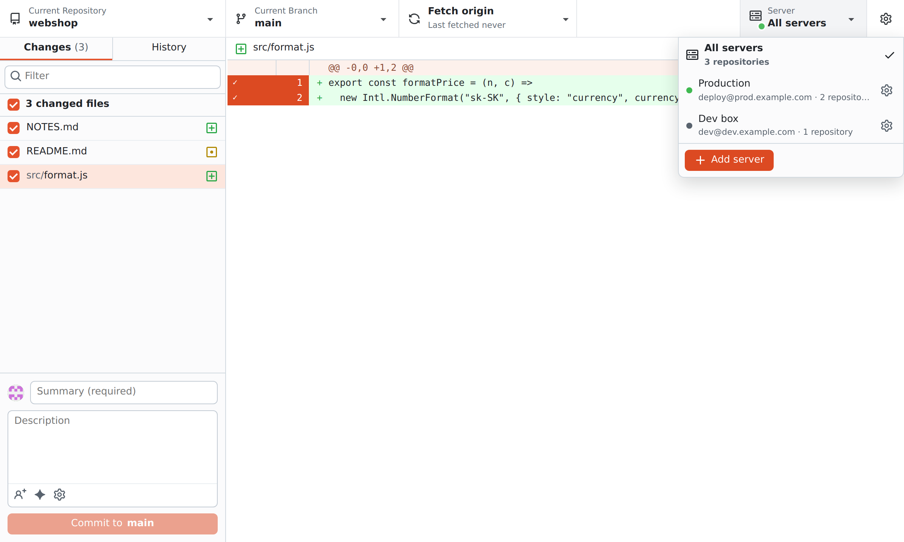

# RemoteGit

A GitHub Desktop-style Git client for repositories that live **on a server**. It connects over SSH, so the code stays on the server while you see changes, diffs, history and branches, and commit, push and pull from your Mac or Windows PC.


## How it works

- Uses the SSH client already on your system (`ssh` on macOS, OpenSSH on Windows 10/11), so your keys, ssh-agent and `~/.ssh/config` just work.
- Keeps **one persistent SSH connection** per server and sends every git command through it, so a refresh is one quick command, not a new login.
- Nothing to install on the server besides `git` and `sh`. Optional extras on the server: the GitHub CLI (`gh`) for pull requests, and Claude Code (`claude`) for AI commit messages.
- While the window is visible, status refreshes every few seconds. Changes made elsewhere on the server (VS Code, vim, an AI agent, …) show up on their own. When the window is hidden, the app does nothing.
- Built with Tauri, so the installer is a few MB and memory use is low.

## Features

**Changes**
- Changed files with checkboxes and a diff with line numbers.
- **Commit only some lines**: click the gutter (or drag over it) to choose lines, or click a `@@` header for the whole block.
- Summary, description, **co-authors** (`@login` or `Name <email>`), and options to bypass hooks, add a Signed-off-by trailer or allow an empty commit.
- **AI commit message**: the ✨ button asks Claude Code on the server to describe the selected changes in the style of your recent commits. No API key in the app.
- **Undo** the last commit. Right-click a file to discard it, add it to `.gitignore`, or copy its path.


**History**
- Commits with author pictures, tags and an ↑ badge on unpushed ones; commit details, changed files and diff.
- Right-click a commit: Amend, Reset to commit, Checkout, Revert, Create branch, Create tag, Cherry-pick, Copy SHA or tag, View on GitHub.


**Branches and remotes**
- Branch list with Default, Recent and Other branches, plus remote branches; create a new branch.
- **Pull Requests** tab: open PRs from the GitHub CLI on the server; click one to check it out.
- **Fetch / Pull / Push / Publish branch** in one button with the ahead/behind counts; the ▾ next to it picks a specific action.


**Servers and repositories**
- Several servers; the **Server** menu filters the repository list to one server or shows all.
- **Test connection** checks SSH, git, the GitHub CLI and Claude Code on the server.
- Add repositories by scanning the server (`~`, `/var/www`, `/srv`), by path, or with a **folder browser** that walks the server's folders.
- Pick your SSH key with a file dialog. "Open in VS Code" opens the repo through Remote-SSH; "Copy SSH command" gives you a terminal in the repo folder.

**Look**
- Two styles: **GitHub** (familiar blue) and **RemoteGit** (coral), each in light and dark, following the system or set by hand (⚙ in the top right).



### Keyboard shortcuts

`⌘` on macOS, `Ctrl` on Windows. Press `⌘/` in the app for the full list.

| Shortcut | Action |
|---|---|
| `⌘1` / `⌘2` | Changes / History |
| `⌘T` / `⌘B` / `⌘⇧L` | Switch repository / branch / server |
| `⌘⇧N` | New branch |
| `⌘P` / `⌘⇧P` / `⌘⇧T` | Push / Pull / Fetch |
| `⌘↩` | Commit |
| `⌘⇧M` | Generate the commit message with AI |
| `⌘⇧A` / `⌘⇧G` | Open in VS Code / on GitHub |
| `⌘⇧⌫` | Discard all changes |
| `⌘R` | Refresh |
| `⌘,` | Settings |
| `Space` | Check or uncheck the selected file |

## Connection requirements

RemoteGit signs in with an **SSH key**; it never fills in passwords. If `ssh user@server` works in a terminal without asking for a password, the app will work too. If not:

```bash
ssh-keygen -t ed25519        # if you don't have a key yet
ssh-copy-id user@server      # uploads the key to the server
```

On Windows (PowerShell), where `ssh-copy-id` isn't available:

```powershell
type $env:USERPROFILE\.ssh\id_ed25519.pub | ssh user@server "mkdir -p ~/.ssh && cat >> ~/.ssh/authorized_keys"
```

**Pushing to GitHub from the server:** either the server has its own SSH key added to GitHub, or turn on **Forward my SSH agent** in the app's server settings so the server uses the keys from your computer.

## Build

### A) Automatically with GitHub Actions (easiest)

1. Open **Actions → Build → Run workflow**.
2. When it finishes (about 10 minutes), download from *Artifacts*:
   - `RemoteGit-macOS` → `.dmg` (universal: Apple Silicon and Intel)
   - `RemoteGit-Windows` → `.msi` and `.exe` installers

Pushing a tag (`git tag v0.1.0 && git push --tags`) also creates a draft GitHub Release with the installers.

### B) Locally

**macOS:**
```bash
xcode-select --install                                   # once
curl https://sh.rustup.rs -sSf | sh                       # once, installs Rust
npm ci
npm run build
# → src-tauri/target/release/bundle/dmg/RemoteGit_0.1.0_aarch64.dmg
```

**Windows:** install [Rust](https://rustup.rs), [Node.js](https://nodejs.org) and *Visual Studio Build Tools* (the "Desktop development with C++" workload). Then:
```powershell
npm ci
npm run build
# → src-tauri\target\release\bundle\msi\  and  \nsis\
```

### First launch (the app is not signed)

- **macOS:** a warning appears the first time you open it. Go to *System Settings → Privacy & Security* and click **Open Anyway**, or run `xattr -cr /Applications/RemoteGit.app` in a terminal.
- **Windows:** SmartScreen → **More info → Run anyway**.

## Development

```bash
npm run dev        # Tauri app with live UI reload
npm run preview    # UI in the browser at http://localhost:1420; commands run in a local sh instead of over SSH
npm test           # git logic tests against real repositories
cd src-tauri && cargo test   # SSH layer tests
```

Layout:

| File | What it does |
|---|---|
| `src-tauri/src/ssh.rs` | persistent SSH connection, framing of each command's output |
| `src-tauri/src/main.rs` | Tauri commands `ssh_connect`, `ssh_exec`, `ssh_disconnect` |
| `src/git.js` | git commands (safely escaped) and parsers for their output |
| `src/app.js` | UI (plain JavaScript, no framework, no build step) |
| `src/styles.css` | styling, light and dark mode |

## Not supported yet

Password login (keys only), resolving merge conflicts inside the app (conflicts are shown; resolve them in an editor, then commit), stash, reordering commits, syntax highlighting in diffs, image diffs, signing commits with a passphrase-protected key.

## Credits

Icons are [Octicons](https://primer.style/octicons) by GitHub Inc., used under the MIT License. RemoteGit is not affiliated with or endorsed by GitHub.
