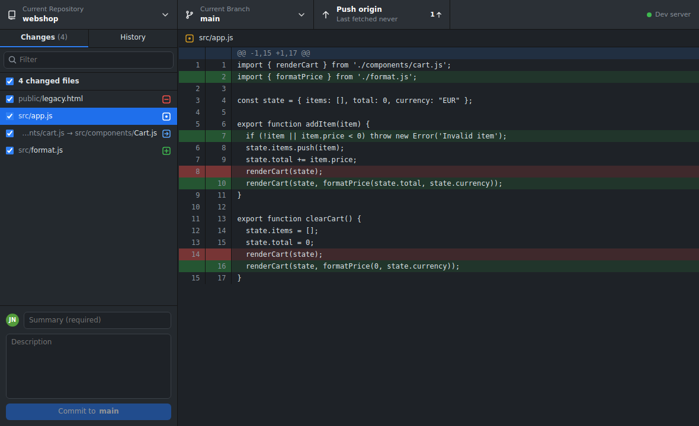
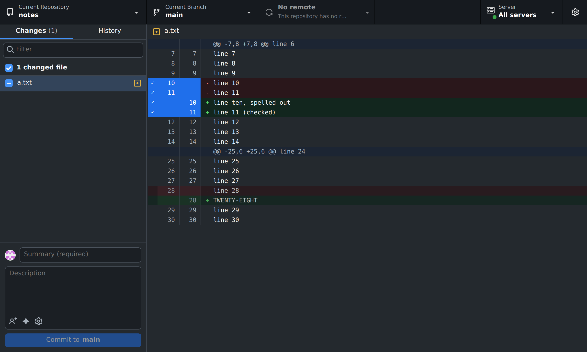
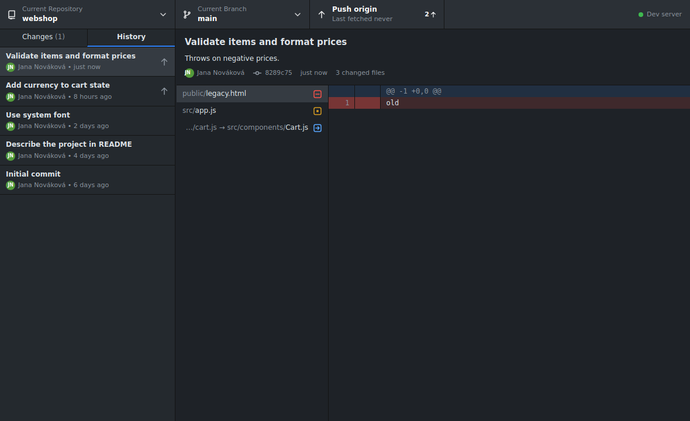
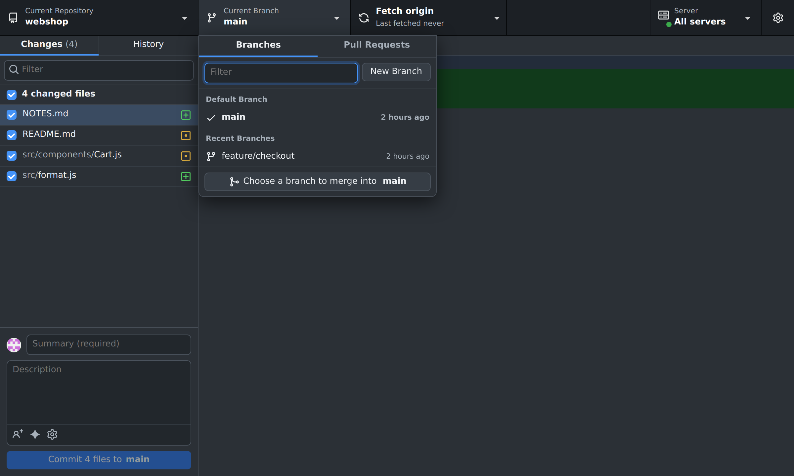
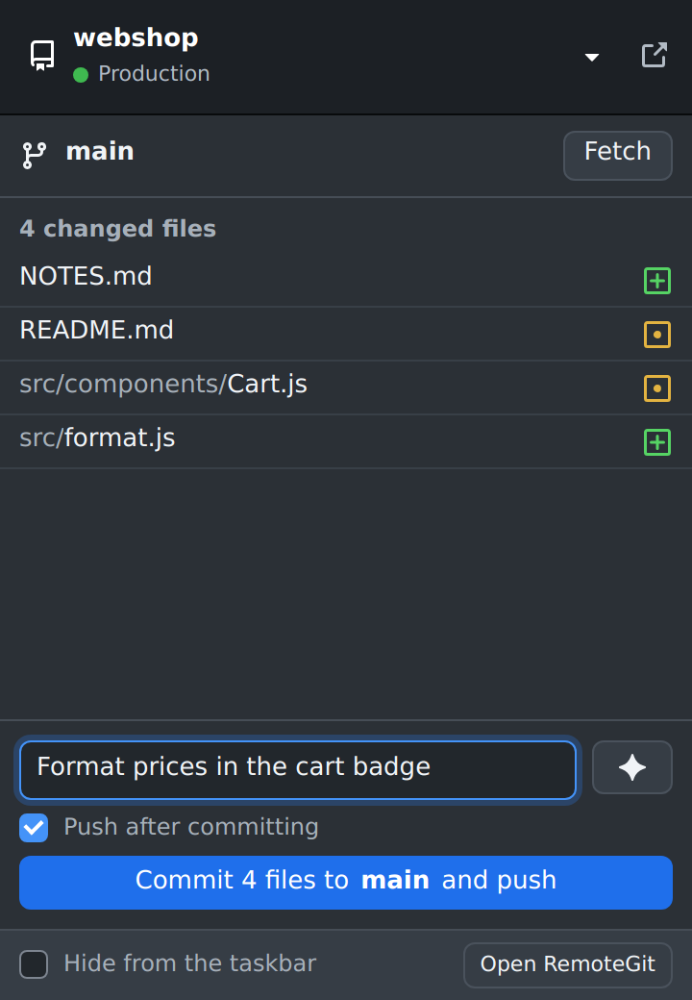
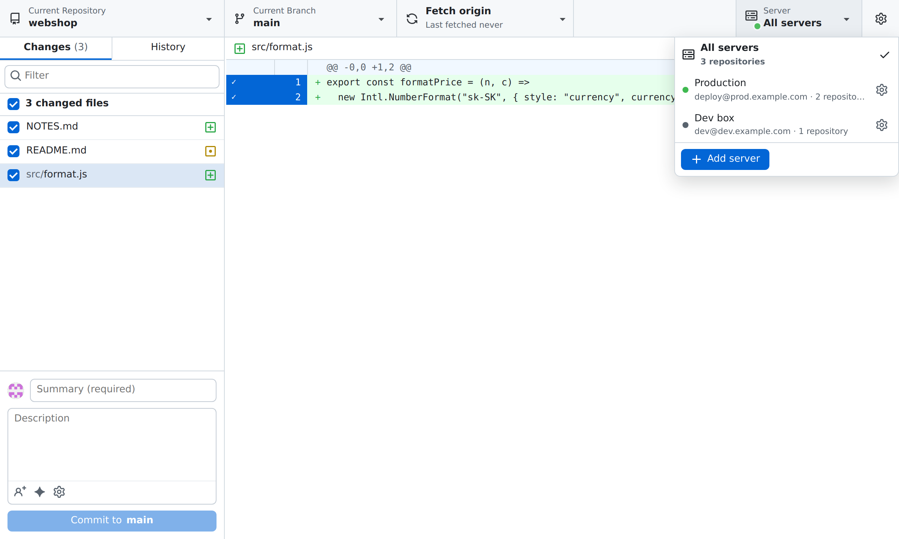

# RemoteGit

A GitHub Desktop-style Git client for repositories that live **on a server**. It connects over SSH, so the code stays on the server while you see changes, diffs, history and branches, and commit, push and pull from your Mac or Windows PC. Repositories on your own computer work too.

## Download

Get the latest version from **[Releases](https://github.com/adammery/remotegit/releases/latest)**: the `.dmg` for macOS (Apple Silicon and Intel) or the `-setup.exe` for Windows.

> **The app is not code-signed** with an Apple or Microsoft certificate, so macOS and Windows warn the first time you open it. It's safe to continue:
> - **macOS:** open the app once, then go to *System Settings → Privacy & Security* and click **Open Anyway**. Or run `xattr -cr /Applications/RemoteGit.app` in Terminal.
> - **Windows:** when SmartScreen says "Windows protected your PC", click **More info → Run anyway**.

RemoteGit checks for new versions on its own and shows a popup with **Install and restart**. You can also check by hand in ⚙ → *Check for updates*, where the current version is shown. Each update is checked against the project's own signing key before it's installed, so only genuine updates go in. That check is separate from Apple or Microsoft code signing.



## How it works

- Uses the SSH client already on your system (`ssh` on macOS, OpenSSH on Windows 10/11), so your keys, ssh-agent and `~/.ssh/config` just work.
- Keeps **one persistent SSH connection** per server and sends every git command through it, so a refresh is one quick command, not a new login.
- Nothing to install on the server besides `git` and `sh`. Optional extras on the server: the GitHub CLI (`gh`) for pull requests, and Claude Code (`claude`) or Codex (`codex`) for AI commit messages.
- While the window has focus, status refreshes every 4 seconds, and right away when you switch back to it. Changes made elsewhere on the server (VS Code, vim, an AI agent, …) show up on their own. When you're in another app, RemoteGit sends nothing to the server. One refresh is about 1.5 KB and a few milliseconds of `git status` on the server.
- Built with Tauri, so the installer is a few MB and memory use is low.

## Features

**Changes**
- Changed files with checkboxes and a diff with line numbers and **syntax highlighting** (GitHub's colors, about 35 languages).
- **Commit only some lines**: click the gutter (or drag over it) to choose lines, or click a `@@` header for the whole block.
- Summary, description, **co-authors** (`@login` or `Name <email>`), and options to bypass hooks, add a Signed-off-by trailer or allow an empty commit.
- **AI commit message**: the ✨ button asks Claude Code or Codex on the server to describe the selected changes in the style of your recent commits. When both are installed, a small menu lets you pick one. Codex runs read-only. No API key in the app.
- **Undo** the last commit. Right-click a file to discard it, add it to `.gitignore`, or copy its path.
- **Stash**: switching branches with changes asks whether to leave them on the branch (stashed) or bring them along; right-click the file list header to stash everything. **Stashed Changes** at the bottom shows the files and diff, with Restore and Discard. One stash per branch, compatible with GitHub Desktop's.



**History**
- Commits with author pictures, tags and an ↑ badge on unpushed ones; commit details, changed files and diff.
- **Search** the history by summary, author, email, tag or the start of a SHA.
- **Images** (PNG, JPEG, GIF, WebP, BMP, ICO, AVIF) show before and after side by side, with their size, in changes, commits and stashes.
- Right-click a commit: Amend, Reset to commit, Checkout, Revert, Create branch, Create tag, Cherry-pick, Copy SHA or tag, View on GitHub.



**Branches and remotes**
- Branch list with Default, Recent and Other branches, plus remote branches; create a new branch.
- Right-click a branch to switch to it, **rename** it, copy its name, view it on GitHub or **delete** it (optionally on the remote too; unmerged commits get a warning first).
- **Merge** another branch into the current one (merge commit or squash) from the bottom of the branch list.
- **Pull Requests** tab: open PRs from the GitHub CLI on the server, with their CI status; click one to check it out.
- **Create Pull Request** (from the ▾ next to Fetch/Push, the no-changes screen or `⌘⇧R`): base branch, title, description, draft, and ✨ to have the AI write the title and description. Unpushed commits are pushed first. Once it exists, the same places offer **View Pull Request**.
- **CI status**: a ✓ / ✗ / ● next to the branch name for the pushed tip, and next to the commit open in History; click it for each check with a link to its run. It comes from GitHub Actions and commit statuses via `gh`, and is polled only while the window has focus (every 30 s while checks run, otherwise every 2 min).
- **Fetch / Pull / Push / Publish branch** in one button with the ahead/behind counts; the ▾ next to it picks a specific action.



**Servers and repositories**
- Several servers; the **Server** menu filters the repository list to one server or shows all.
- **This computer**: use repositories on your own Mac or PC as well, like GitHub Desktop (needs git; on Windows, Git for Windows).
- **Test connection** checks SSH, git, the GitHub CLI, Claude Code and Codex on the server.
- Add repositories by scanning the server (`~`, `/var/www`, `/srv`), by path, or with a **folder browser** that walks the server's folders.
- **Clone** a repository onto the server: pick one of your GitHub repositories (via the GitHub CLI there, so private ones work) or paste any Git URL.
- Pick your SSH key with a file dialog. "Open in VS Code" opens the repo through Remote-SSH; "Copy SSH command" gives you a terminal in the repo folder.

**Menu bar**
- Turn on **Show in menu bar** (⚙ in the top right) for an icon in the macOS menu bar or the Windows system tray, with the number of changes next to it.
- Click it for a small window: changed files, commit everything with an optional AI message, push or pull, and Undo. Handy when an AI does the work on the server and you only check in now and then.
- **Hide from the Dock** keeps RemoteGit only in the menu bar; closing the main window leaves it running there.



**Look**
- Light and dark mode, following the system or set by hand (⚙ in the top right).
- The newest commit can be undone from under the Commit button until it's pushed.



### Keyboard shortcuts

`⌘` on macOS, `Ctrl` on Windows. Press `⌘/` in the app for the full list.

| Shortcut | Action |
|---|---|
| `⌘1` / `⌘2` | Changes / History |
| `⌘T` / `⌘B` / `⌘⇧L` | Switch repository / branch / server |
| `⌘⇧N` | New branch |
| `⌘⇧O` | Clone repository |
| `⌘⇧R` | Create or view the pull request |
| `⌘⇧S` | Stash all changes |
| `⌘F` | Filter files / search history |
| `⌘P` / `⌘⇧P` / `⌘⇧T` | Push / Pull / Fetch |
| `⌘↩` | Commit |
| `⌘⇧M` | Generate the commit message with AI |
| `⌘⇧A` / `⌘⇧G` | Open in VS Code / on GitHub |
| `⌘⇧⌫` | Discard all changes |
| `⌘R` | Refresh |
| `⌘,` | Settings |
| `Space` | Check or uncheck the selected file |
| `→` / `←` | History: move from the commit list to the commit's files and back |

## Connection requirements

RemoteGit signs in with an **SSH key**; it never fills in passwords. If `ssh user@server` works in a terminal without asking for a password, the app will work too. If not:

```bash
ssh-keygen -t ed25519        # if you don't have a key yet
ssh-copy-id user@server      # uploads the key to the server
```

On Windows (PowerShell), where `ssh-copy-id` isn't available:

```powershell
type $env:USERPROFILE\.ssh\id_ed25519.pub | ssh user@server "mkdir -p ~/.ssh && cat >> ~/.ssh/authorized_keys"
```

**Pushing to GitHub from the server:** either the server has its own SSH key added to GitHub, or turn on **Forward my SSH agent** in the app's server settings so the server uses the keys from your computer.

## Build

### A) Automatically with GitHub Actions (easiest)

1. Open **Actions → Build → Run workflow**.
2. When it finishes (about 10 minutes), download from *Artifacts*:
   - `RemoteGit-macOS` → `.dmg` (universal: Apple Silicon and Intel)
   - `RemoteGit-Windows` → `.msi` and `.exe` installers

### Publishing a new version

1. Raise the version in `package.json`, `src-tauri/tauri.conf.json` and `src-tauri/Cargo.toml`.
2. Commit, then tag and push: `git tag v0.3.0 && git push && git push --tags`.
3. The Build workflow creates the release with both installers and the `latest.json` that installed apps update from.

Signing needs the `TAURI_SIGNING_PRIVATE_KEY` repository secret (made with `npx tauri signer generate`); the matching public key is in `tauri.conf.json`.

### B) Locally

**macOS:**
```bash
xcode-select --install                                   # once
curl https://sh.rustup.rs -sSf | sh                       # once, installs Rust
npm ci
npm run build
# → src-tauri/target/release/bundle/dmg/RemoteGit_0.1.0_aarch64.dmg
```

**Windows:** install [Rust](https://rustup.rs), [Node.js](https://nodejs.org) and *Visual Studio Build Tools* (the "Desktop development with C++" workload). Then:
```powershell
npm ci
npm run build
# → src-tauri\target\release\bundle\msi\  and  \nsis\
```

### First launch (the app is not signed)

- **macOS:** a warning appears the first time you open it. Go to *System Settings → Privacy & Security* and click **Open Anyway**, or run `xattr -cr /Applications/RemoteGit.app` in a terminal.
- **Windows:** SmartScreen → **More info → Run anyway**.

## Development

```bash
npm run dev        # Tauri app with live UI reload
npm run preview    # UI in the browser at http://localhost:1420; commands run in a local sh instead of over SSH
npm test           # git logic tests against real repositories
cd src-tauri && cargo test   # SSH layer tests
```

Layout:

| File | What it does |
|---|---|
| `src-tauri/src/ssh.rs` | persistent SSH connection, framing of each command's output |
| `src-tauri/src/main.rs` | Tauri commands (`ssh_connect`, `ssh_exec`, …), the menu bar icon and window |
| `src/git.js` | git commands (safely escaped) and parsers for their output |
| `src/app.js` | main window UI (plain JavaScript, no framework, no build step) |
| `src/tray.js` | the small menu bar window |
| `src/ui.js` | helpers both windows share (DOM, menus, stored settings) |
| `src/styles.css` | styling, light and dark mode |
| `src/vendor/` | highlight.js for syntax highlighting |

## Not supported yet

Password login (keys only), resolving merge conflicts inside the app (conflicts are shown; resolve them in an editor, then commit), reordering commits, signing commits with a passphrase-protected key.

## License

Free to use, modify, fork and share, including at work. You may not sell RemoteGit or a product or service built mainly on it. Keep the copyright and license notice in copies and forks. The terms are the MIT License with the [Commons Clause](https://commonsclause.com) condition; see [LICENSE](LICENSE).

## Credits

Icons are [Octicons](https://primer.style/octicons) by GitHub Inc., used under the MIT License. Syntax highlighting uses [highlight.js](https://highlightjs.org) (BSD-3-Clause, see `src/vendor/highlight.js-LICENSE`). RemoteGit is not affiliated with or endorsed by GitHub.
